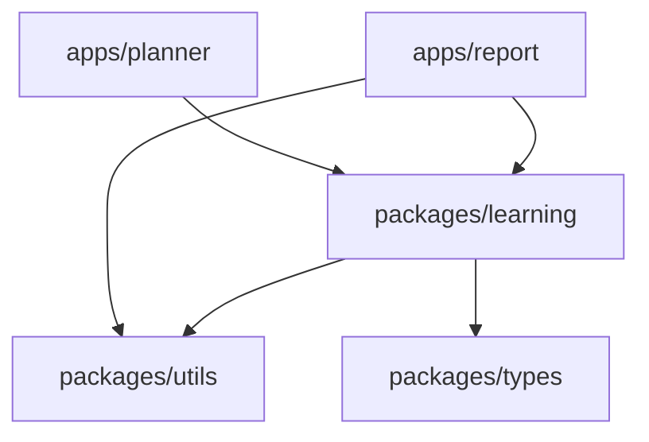

# 教学 Monorepo 架构

## 目标

用五个小工作区展示完整工程链路：定义共享契约、实现纯函数、组合领域规则、编写应用、按依赖顺序构建，再从消费方验证类型与行为。所有示例均为独立编写的课程数据和逻辑。

## 分层和依赖图



| 层 | 内容 | 依赖约束 |
| --- | --- | --- |
| 应用 | 输入、执行流程、控制台展示 | 可以依赖包，不依赖其他应用 |
| 领域包 | 课程校验、学习计划、进度计算 | 依赖工具和类型，不依赖应用 |
| 工具包 | 分组、百分比格式化 | 无业务知识和环境副作用 |
| 类型包 | Lesson 与 StudySummary | 只描述数据契约 |
| 根工程 | 配置、构建入口、测试与 CI | 工程依赖集中声明，不代替包的依赖声明 |

TypeScript 配置由根 tsconfig.base.json 共享，包内配置只声明源码与产物目录。单份配置不单独创建发布包，减少不必要层级。

## 工作区与公共入口

pnpm-workspace.yaml 只发现 `apps/*` 和 `packages/*`。内部依赖写成 `workspace:*`，保证解析到本地包而不是同名注册表包。包的 exports 仅暴露公共入口，消费者通过 `@demo/learning` 导入，不穿透其他包的 src。

根测试工程本身也是消费方，因此在根 devDependencies 中声明三个本地包。这些包不存在于公共 npm 注册表，也不需要发布。

工作区检查器检查 package.json 声明的依赖图，发现缺失包、重复包名、错误 workspace 协议、循环依赖和依赖应用的边。它不是源码级 import 检查器；跨目录相对导入还需要代码审查，必要时再引入 ESLint 边界规则。

## 构建链路

```text
共享类型 ─┐
         ├─→ 课程领域包 ─→ 学习计划 / 进度报告
纯函数工具 ┘                 ↑
          └──────────────────┘
```

执行 `pnpm -r run build` 时按包依赖拓扑排序，同一层可并行。领域包导出的声明会引用共享类型包，所以类型依赖也必须显式声明。

每个包使用 tsc 输出 ESM、声明文件和 source map。根 build 先清理所有 dist，避免已经删除的源码残留为旧产物。类型检查也先构建，确保消费者能够解析依赖包的声明。当前规模不需要 Turborepo；未来构建缓存确有收益时再添加。

NodeNext 使用真实 Node ESM 规则。需要新增包内相对 import 时，源码写 `.js` 扩展名，TypeScript 会在开发期解析对应 `.ts`，编译后路径可直接运行。不使用源码路径别名绕过包入口。

## 数据规则与错误处理

课程必须有唯一非空 id、非空标题以及正整数分钟数。进度按完成分钟数计算，而非简单按课程数量计算；重复完成 id 只计一次，未知 id 明确抛错。空课表的进度为 0，累计时长不得超过安全整数范围。

示例数据由工厂函数每次创建，避免跨应用或测试共享可变数组。返回分组是浅拷贝，课程对象属性在类型层为只读，不承诺运行时深冻结。

当前输入是仓库内受 TypeScript 检查的数据；未来接入 HTTP、文件或用户输入时，必须在入口为 unknown 数据增加完整运行时 schema 校验，不能仅靠类型断言。

## 质量与交付

本地和 CI 都执行冻结锁文件安装、check、demo。测试覆盖领域边界、工作区依赖规则、生成声明的消费契约和真实应用进程输出。没有虚假的成功占位脚本。

CI 使用 Node 24，pnpm 版本由 packageManager 固定。dist、node_modules 和环境文件不进入源码。全部 workspace 包保持 private，避免误发布。CI 文件已提供，但远程 Actions 的执行结果需推送后另行确认。

## 扩展原则

先在合适层级增加功能，再声明依赖、导出 API、添加消费测试与文档。只有出现第二个真实消费方时才提取新的共享包。需要浏览器界面时新增 apps/web；需要远程数据时由应用适配接口，不把请求和密钥写进通用工具包。
